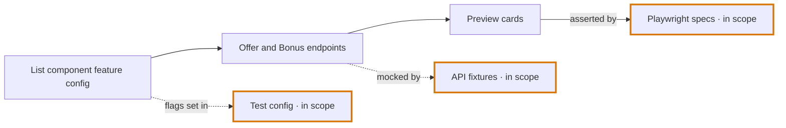

# Align Offer and Bonus card E2E tests with the list component feature configs

**Priority:** High · **Estimate:** 3–5 days · **Component:** Offer & Bonus preview cards · **Labels:** `qa`, `e2e`, `playwright`, `offers`

## Description
The FE team is rolling out feature config changes to the list components, which change the data and endpoints behind the Offer and Bonus preview cards. The Playwright suite will fail or give false results unless it ships in sync with the FE release.

## In Scope
- Update Offer and Bonus card specs for new, changed, and removed fields.
- Update API mocks and fixtures for the new endpoints and data shapes.
- Add new feature flags and routes to the test config.

## Out of Scope
- New coverage for flows the config change does not touch.
- Visual regression on the preview cards.
- Changes to the FE implementation or the API contract.

## Acceptance Criteria
- [ ] Offer and Bonus card specs pass against the updated FE build in CI on the feature branch.
- [ ] Every new or changed card field has an explicit assertion.
- [ ] No test references a removed field or a deprecated endpoint.

## Diagram

