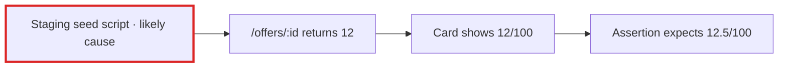

# Root Cause Triage - my-offers-expanded-card.spec.ts > displays fractional wager progress

**Category:** Test Data Issue · **Confidence:** Medium · **Severity:** Medium

> **Likely cause:** The staging seed script now saves `wagerProgress` as an integer, so the fractional assertion no longer has the data it needs. **Do next:** Inspect the seeded value for the test user. Do not log a product bug yet.

## Evidence
- The API response in the failing run returns `wagerProgress: 12`, not `12.5`.
- The seed script changed 3 days ago, and it now rounds `wagerProgress` for new test users.
- The test fails only on the nightly staging run, not on PR pipelines that use mocked fixtures.
- `formatWagerProgress()` and the selectors have not changed in 7 days.

## Failure Chain

## Other Possibilities
- Backend rounding change in the wager service: check the `wager-service` change log for the last 7 days.
- Assertion runs before the partial wager is saved: unlikely, since the failure repeats on the same fixture user.

## Next Steps
1. Re-run the seed locally and inspect the saved `wagerProgress` for the test user.
2. Call `/offers/:id` with the failing user and confirm the field's type and value.
3. Restore fractional values in the seed, or add a fixture user with a known fractional wager.
4. Keep the test out of PR-blocking runs until the seed is fixed.
