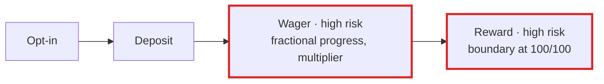

# QA Test Plan - My Offers Wagering Progress Display

**Overall Risk:** Medium · **Environment:** Staging with `my-offers-v2` enabled · **Timeline:** 2026-05-08 to 2026-05-13

> **Objective:** Prove that the wagering multiplier and fractional progress on the expanded card and stepper are correct in every campaign state, supported locale, and device, and that they match the API.

## Scope

**In Scope**
- Wagering progress and multiplier on the expanded card.
- Stepper sync with the expanded card.
- `/offers/:id` API mapping.
- Locale decimal separators.

**Out of Scope**
- Wager service backend logic and rounding rules.
- Deposit and payment flows.
- Push notifications and email triggers.
- Load and stress testing.

## Flow Under Test

## Test Approach

| Test type | What it proves | How |
|---|---|---|
| Functional | Progress, multiplier, and stepper are right, including null values and 99.99 / 100 / 100.01 | Manual and Playwright E2E |
| Integration | API values map correctly to the UI | Postman with Playwright UI checks |
| Usability | Labels stay readable at narrow widths and in long-text locales | Manual exploratory |
| Security | No user identifiers leak through the helper or logs | Log and code review |

## Test Priorities

| Test area | What to verify | WRPN | L, I, D, E |
|---|---|---|---|
| Fractional progress | `12.5/100` renders correctly | 60 | 4, 5, 3, 1 |
| Multiplier display | `35x` appears on the expanded card | 48 | 3, 4, 4, 1 |
| Locale decimal separator | Comma vs dot in non-default locales | 36 | 3, 3, 4, 1 |
| Stepper sync after wager | Stepper shows the updated progress | 32 | 2, 4, 4, 1 |
| API contract mapping | `/offers/:id` fields map to the UI | 24 | 2, 4, 3, 1 |
| Boundary at 100/100 | Complete state renders correctly | 24 | 2, 3, 4, 1 |

*WRPN = Likelihood × Impact × Detectability × Effort*

## Environment and Data
- Staging that mirrors production, with `my-offers-v2` enabled.
- Latest browsers on desktop, iOS, and Android.
- Stable broadband, plus Slow 3G through DevTools throttling.
- Seeded users in each campaign state and progress type.

## Entry and Exit Criteria

**Entry**
- [ ] MYOFF-482 acceptance criteria are approved.
- [ ] Staging is stable with `my-offers-v2` enabled.
- [ ] Seeded users are available in every required campaign state.

**Exit**
- [ ] All High and Medium priority cases are executed.
- [ ] No Critical or High defects are open on the wagering progress display.
- [ ] One automated case covers fractional progress.

## Top Risks

| Risk | Severity | Likelihood | RPN | Mitigation |
|---|---|---|---|---|
| Decimal separators wrong in some locales | High | Medium | 24 | Add locale-aware cases and a Playwright matrix |
| Seed data drift causes false negatives | Medium | High | 18 | Pin fixture users and validate the seed before runs |
| Stepper and card desynchronize after refresh | Medium | Medium | 12 | Add a sync assertion after each state change |

*RPN = Severity × Likelihood × Detectability*
